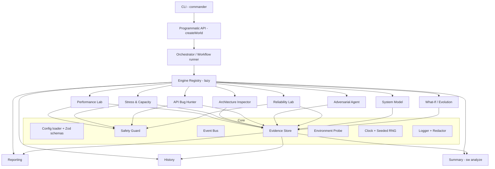

# 02 — Architecture

## 1. Architectural style

A **modular monolith** in one npm package (`second-world`), organised as **core + engines + adapters**:

- **Core**: small, dependency-light, always loaded. Contains config, safety, events, evidence, probes and the registry.
- **Engines**: independent feature modules, loaded on demand with dynamic `import()`.
- **Adapters**: swappable integrations such as HTTP clients, telemetry readers, storage, fault injectors and reporters.

The boundaries are set up so that splitting into separate packages later (`@second-world/core`, `@second-world/perf`, …) only means moving folders, not rewriting code.



## 2. Layering rules (enforced by lint)

| Layer | May import | Must not import |
|---|---|---|
| `core/*` | Node built-ins, `zod`, tiny utils | Any engine, any adapter |
| `engines/<x>/*` | `core/*`, `shared/*`, own adapters via interfaces | Other engines directly. Use the registry or events. |
| `adapters/*` | `core/*` interfaces | Engines |
| `cli/*` | Public API only | Engine internals |

Enforce with `dependency-cruiser` (or ESLint `import/no-restricted-paths`) in CI. Engines talk to each other only through:

1. **The Evidence Store** (read findings/measurements of other engines).
2. **The Event Bus** (subscribe to `perf.stage.completed`, etc.).
3. **Typed engine outputs** passed by the orchestrator in a workflow.

## 3. Source layout (v2)

```text
second-world/
├── src/
│   ├── index.ts                 # public API: createWorld, defineConfig, types
│   ├── cli/
│   │   ├── main.ts              # commander program, global flags
│   │   ├── commands/            # perf, stress, inspect, bugs, agent, reliability, model,
│   │   │                        # whatif, evolve, analyze, report, history, doctor, init
│   │   └── render/              # TTY renderer, plain renderer, progress
│   ├── core/
│   │   ├── world.ts             # World facade (lazy engine getters)
│   │   ├── orchestrator.ts      # runs workflows (DAG of engine steps)
│   │   ├── registry.ts          # engine/plugin registry, capability requirements
│   │   ├── config/              # schemas, loader, profiles, env overlay, units parser
│   │   ├── safety/              # target guard, budgets, approvals, kill switch
│   │   ├── events.ts            # typed event bus
│   │   ├── evidence/            # Finding, Evidence, Measurement types + store
│   │   ├── probe/               # environment & capability detection
│   │   ├── clock.ts             # monotonic clock abstraction (testable)
│   │   ├── rng.ts               # seeded PRNG (xoshiro128**)
│   │   ├── cancel.ts            # AbortController tree helpers
│   │   ├── errors.ts            # error hierarchy with codes
│   │   └── log/                 # logger + secret redaction
│   ├── shared/
│   │   ├── ds/                  # ring buffer, binary heap, deque, semaphore, LRU, union-find
│   │   ├── stats/               # HDR wrapper, Welford, bootstrap, Mann-Whitney, MAD, EWMA
│   │   ├── graph/               # directed graph, BFS/DFS, Tarjan, toposort, impact
│   │   └── util/                # durations, bytes, hashing, ULID, path utils
│   ├── engines/
│   │   ├── performance/         # scheduler, executors, workers, metrics, thresholds
│   │   ├── stress/              # stage planner, capacity analysis, knee detection
│   │   ├── architecture/        # discovery, parser, extractors, rules, graph builder
│   │   ├── bugs/                # contracts, generators, boundary, property, stateful, authz
│   │   ├── agent/               # planner, bandit, scenario generator, safety validator
│   │   ├── reliability/         # fault injectors, scenarios, recovery measurement
│   │   ├── model/               # system model graph, entity resolution, enrichment
│   │   ├── experiments/         # what-if runner, evolution runner, comparisons
│   │   ├── summary/             # deterministic cross-report summary (sw analyze)
│   │   ├── reporting/           # aggregators, formatters (tty, json, md, html, junit, sarif)
│   │   └── history/             # stores (jsonl; sqlite planned), baselines, regression detection
│   ├── adapters/
│   │   ├── http/                # undici adapter, fetch adapter (fallback)
│   │   ├── faults/              # toxiproxy, in-process proxy, docker
│   │   ├── loadgen/             # optional k6 / artillery bridges
│   │   └── telemetry/           # OpenTelemetry OTLP receiver/reader
│   └── types/                   # public type exports
├── tests/                       # unit, integration, e2e, fixtures, golden reports
├── examples/                    # sample apps (express, fastify, nest, hono) + configs
├── schemas/                     # generated JSON Schemas (config, report) for editors/CI
├── docs/
├── package.json  tsconfig.json  vitest.config.ts  biome.json  .dependency-cruiser.cjs
└── README.md  LICENSE  CHANGELOG.md  SECURITY.md  CONTRIBUTING.md
```

## 4. Key core abstractions

```ts
// Every engine implements this contract.
export interface Engine<I, O extends EngineResult> {
  readonly id: EngineId;                       // "performance", "architecture", ...
  readonly version: string;
  readonly inputSchema: z.ZodType<I>;          // validated before run
  readonly requires: CapabilityRequirement[];  // e.g. { cap: "network.target" }, { cap: "docker", optional: true }
  run(input: I, ctx: EngineContext): Promise<O>;
}

export interface EngineContext {
  signal: AbortSignal;          // cancellation, propagated everywhere
  clock: Clock;                 // monotonic time, injectable for tests
  rng: Rng;                     // seeded
  log: Logger;                  // redacting logger
  events: EventBus;             // progress & cross-engine signals
  evidence: EvidenceStore;      // read + write findings/measurements
  safety: SafetyGuard;          // must be consulted before any outbound action
  env: EnvironmentReport;       // result of probe
  config: ResolvedConfig;
}

export interface EngineResult {
  engine: EngineId;
  runId: string;                // ULID
  status: "passed" | "failed" | "partial" | "skipped" | "error" | "cancelled";
  startedAt: string; endedAt: string;   // ISO-8601 UTC
  findings: Finding[];
  limitations: Limitation[];    // what could not be determined, and why
  artifacts: ArtifactRef[];     // raw data files, HAR, graphs
}
```

### 4.1 Lazy engine loading (the "dynamic" part)

```ts
const builtins: Record<EngineId, () => Promise<EngineModule>> = {
  performance:  () => import("./engines/performance/index.js"),
  architecture: () => import("./engines/architecture/index.js"), // pulls in `typescript` only here
  model:        () => import("./engines/model/index.js"),
  // ...
};
```

`world.performance.test()` never loads the TypeScript compiler (~10 MB), so startup stays fast.

### 4.2 Orchestrator and workflows

A **workflow** is a DAG of engine steps declared in config or code. The orchestrator topologically sorts the steps (Kahn's algorithm) and runs independent steps in parallel with a concurrency limit. It passes typed outputs downstream, and a failed step either stops its dependants or lets them continue (`continueOnError`).

```ts
workflow: {
  steps: {
    inspect: { engine: "architecture" },
    perf:    { engine: "performance", after: [] },
    bugs:    { engine: "bugs" },
    report:  { engine: "reporting", after: ["inspect", "perf", "bugs"] },
  }
}
```

### 4.3 Event bus

A typed, synchronous-dispatch, async-safe emitter (no external dep). Events are namespaced: `run.started`, `perf.tick` (1 Hz live stats), `perf.stage.completed`, `finding.created`, `safety.blocked`, `run.cancelled`. Renderers, history and plugins subscribe. **The hot path never awaits listeners**: ticks are pushed into a ring buffer and listeners drain it.

### 4.4 Cancellation

A single root `AbortController` per run, with child controllers per engine, stage and request (`AbortSignal.any`). `Ctrl+C` once means a graceful stop: stop scheduling, drain in-flight up to the grace period, write a partial report. `Ctrl+C` twice means a hard abort. A cancelled run is still a valid report with `status: "cancelled"`.

### 4.5 Error model

```text
SecondWorldError (code, hint, cause)
├── ConfigError          SW_CONFIG_*     → exit 2
├── SafetyError          SW_SAFETY_*     → exit 3
├── CapabilityError      SW_CAP_*        → exit 4 (or skipped if optional)
├── TargetError          SW_TARGET_*     (target unreachable before start) → exit 5
├── EngineError          SW_ENGINE_*     → exit 70
└── InternalError        SW_INTERNAL     → exit 70
```

Errors carry a human **hint** ("Target resolves to ::1 but server listens on 127.0.0.1 — set `target` to `http://127.0.0.1:3000`").

### 4.6 Concurrency model

Several `sw` processes may run at once on one project (two terminals, parallel CI jobs). What is
guaranteed, with the test that checks it (`tests/unit/concurrency/`, `tests/integration/concurrency/`):

| State | Mechanism | Guarantee | Test |
|---|---|---|---|
| History index `runs.jsonl` and run bodies `runs/<id>.json.gz` | Writer lock `.lock` (created with its owner record via temp file + hard link; O_EXCL fallback); body written to a temp file, fsynced and renamed, then one O_APPEND write of the index line, fsynced | No lost, torn or interleaved records; one record per run under its own run id; a body is in place before its index line | `cli-parallel` (4 parallel `sw perf`), `history-writers` (8 parallel `world.history.save`, 8 store instances × 4 appends + live reader) |
| Stale history lock | Stale = holder pid dead on this host, older than 60 s, or still empty after 2 s; waiters that find the same stale lock serialise through `.lock.break` (O_EXCL) and re-check before removing it | One holder at a time even when several waiters break the same stale lock; a writer killed while holding or creating the lock does not block later saves | `history-lock`, `cli-parallel` ("killed mid-write") |
| Crash mid-write | Readers skip an unreadable index line (e.g. a record cut short by a kill) and log a warning once; the next append starts on a fresh line; `sw history verify` lists it; `sw history prune` deletes leftover temp files | Later reads and writes keep working; records already acknowledged survive | `history-writers` ("cut off mid-append"), `cli-parallel` |
| `baselines.json` | Read-modify-write under the history lock, atomic replace | No lost update between concurrent `setBaseline` | `history-writers` |
| Report files (`report.json`, `.md`, `.junit.xml`, …) | Unique temp file + rename (retry on Windows EPERM/EBUSY) | Each file is always one complete report. Fixed names: with a shared `-o` dir the **last writer wins per file**, so files of one directory can come from different runs. Use a separate `-o` per parallel run. | `history-writers` ("8 writers to the same report file"), `cli-parallel` |
| Ctrl+C (SIGINT/SIGTERM) | First signal: `world.cancel()` → graceful stop; second: exit 130 at once | First: exit 130, a complete partial report, no temp/lock/`pending-*` files left; an engine interrupted before it started also exits 130 (not 3). `sw evolve`: no git worktree, temp checkout or candidate app process left | `lifecycle`, `evolve-interrupt`, `cancel-before-start` |
| Process exit | — | `perf`, `stress`, `bugs` exit on their own after finishing (no leaked handle keeps the process alive) | `lifecycle` ("commands exit on their own") |
| Safety rate cap | One world-wide GCRA (plus a per-lease one when a lease asks for less); decisions are synchronous, so concurrent VUs cannot overshoot | Concurrent callers on one lease, and two concurrent leases together, stay within `maxRps` + burst | `safety-rate` |

Not guaranteed (known, tracked): model snapshots
and the architecture facts cache use a per-process temp name, so two concurrent saves inside one
process can fail (`snapshot-writers`, expected-fail). The Ctrl+C tests emulate the signal inside the
process on every OS (Windows cannot deliver SIGINT to a child); the OS signal itself is tested on
macOS/Linux in `tests/e2e/cli.test.ts`.

## 5. Data flow of a single performance run

```text
config file/CLI flags ─► loader (c12) ─► Zod validate ─► unit normalise ─► profile/env overlay
   ─► Safety Guard (host allow-list, budgets) ─► Env Probe (cpu quota, fd limit, proxy)
   ─► Scheduler (open/closed model) ─► Executor (undici pool) ─► per-worker HDR histograms
   ─► 1 s window ring buffer ─► live renderer
   ─► end: merge histograms ─► thresholds ─► findings ─► Evidence Store ─► reporters ─► exit code
```

## 6. Architecture decision records (summary)

| ADR | Decision | Rationale | Revisit when |
|---|---|---|---|
| 001 | Modular monolith, one package | Fast iteration, one version | >3 engines need independent release cadence |
| 002 | ESM-first, Node ≥ 22.19 (tested on 22/24/26), dual ESM/CJS build of public API | Modern Node, still consumable by CJS users | — |
| 003 | `undici` as HTTP engine (not `axios`/`got`) | Connection pooling, timing hooks, highest throughput in Node, ships with Node | — |
| 004 | HDR histograms for latency | Fixed memory, O(1) record, mergeable, exact-within-precision percentiles | — |
| 005 | Open-loop scheduling as default for rate tests, closed-loop for VU tests, CO correction always on | Avoid *coordinated omission* | — |
| 006 | No native addons in core | Works on every OS/arch/libc without compilers | — |
| 007 | Zod v4 as single source of truth for config & report schemas, JSON Schema generated | Types + validation + editor autocomplete from one place | — |
| 008 | JSONL history first, `node:sqlite` later (not implemented; deferred until it is no longer experimental) | Zero-dependency storage; SQL when querying matters | History > ~10k runs |
| 009 | No AI or LLM anywhere; every result is deterministic (measurement, analysis or code) | Reproducible, explainable results; no code or data sent to third parties | — |
| 010 | Static analysis never executes user code | Safety. Config loading of *our own* config file is the only execution | — |
| 011 | Embed k6/Artillery only as optional adapters | Native engine covers 90 %; bridges for users who already have scripts | — |
